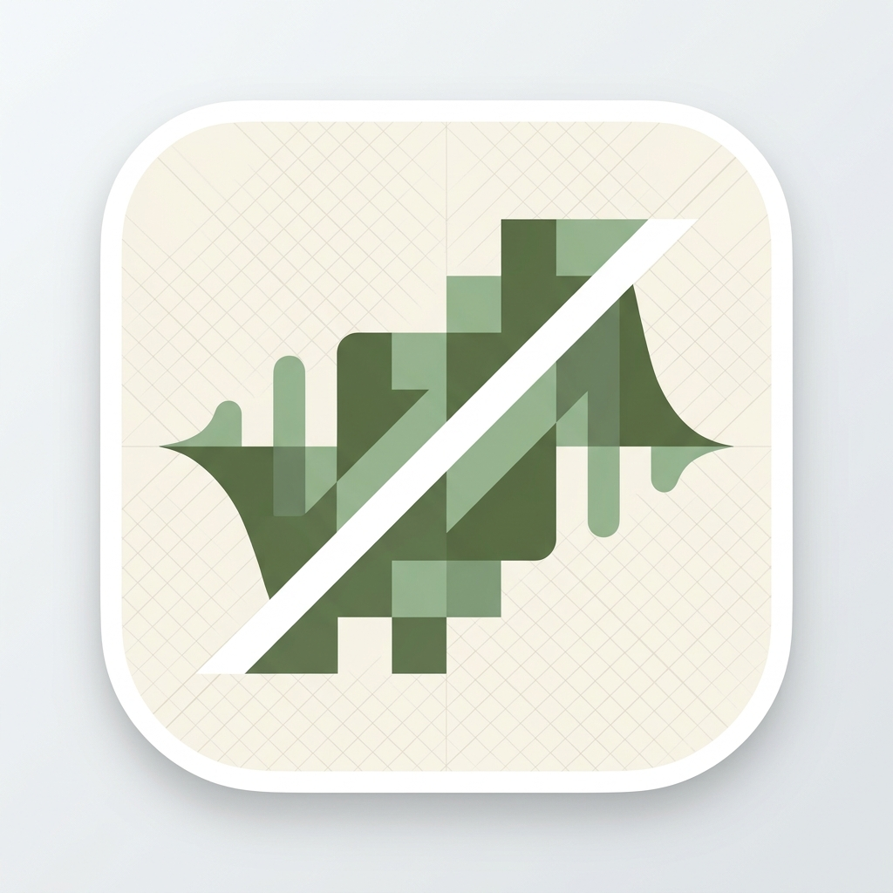
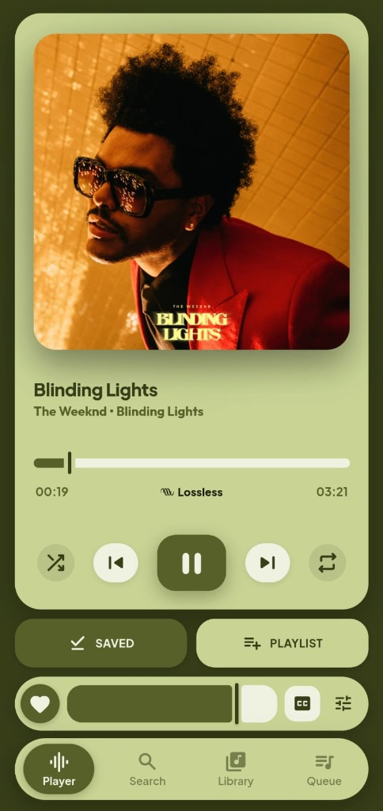
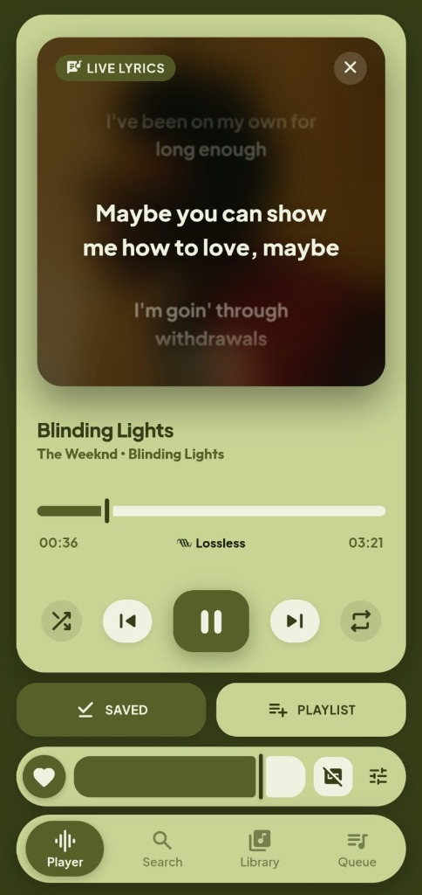
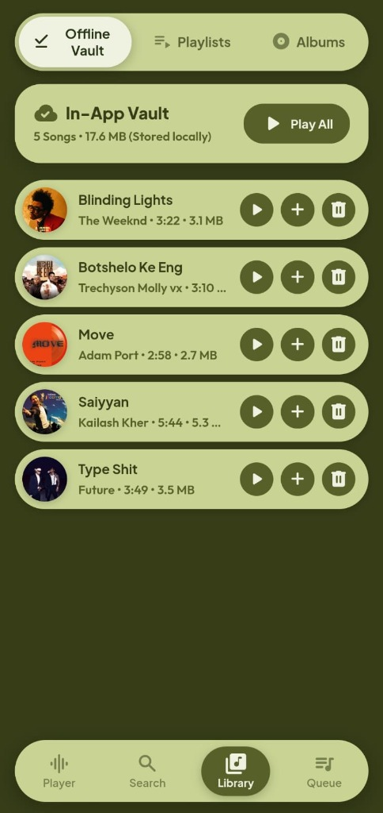
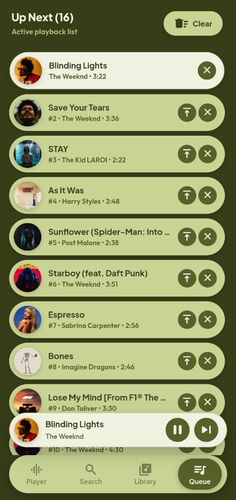
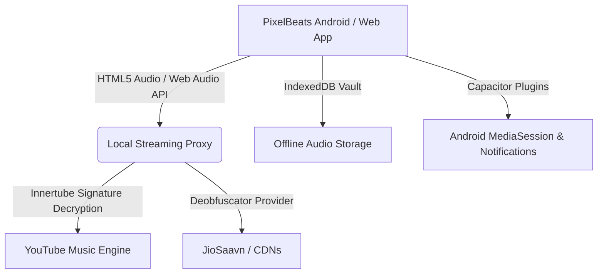

  

  <h1>PixelBeats</h1>

  

    <strong>Redefining the Material You Music Experience on Android.</strong>
     
    <em>High-performance, privacy-focused, Material Design 3 streaming audio player with an offline vault.</em>
  

  

    <a href="#-showcase"><b>Showcase</b></a> •
    <a href="#-features"><b>Features</b></a> •
    <a href="#-architecture"><b>Architecture</b></a> •
    <a href="#-download"><b>Download</b></a> •
    <a href="#-tech-stack"><b>Tech Stack</b></a> •
    <a href="#-license"><b>License</b></a>
  

  

    
    
    
    
    
  

 

---

> [!CAUTION]
> **IMPERSONATION WARNING — PIXELBEATS IS NOT ON GOOGLE PLAY**
>
> **PixelBeats has no official Google Play Store listing.** The PixelBeats maintainers have **not published, authorized, or endorsed any application on Google Play** under the PixelBeats name.
>
> Google Play listings that use the **PixelBeats name, logo, app icon, screenshots, or other official branding** are **unofficial third-party listings**, even if they look identical to this project. They are **not verified or supported by the PixelBeats maintainers** and should **not be mistaken for official releases**. Their contents and safety cannot be guaranteed.
>
> **Get the official PixelBeats only from trusted sources:** [GitHub Releases](https://github.com/prajoy-ux/PixelBeats/releases/latest).
>
> If you encounter a Google Play listing impersonating PixelBeats, **report it to Google Play** and [notify the maintainers](https://github.com/prajoy-ux/PixelBeats/issues/new).

---

> [!WARNING]
> **Forks are not supported in any way.**  
> We do not provide support, maintenance, troubleshooting, or assistance for any forked version of this project. If you choose to use a fork, you do so at your own risk.
>
> **PixelBeats** isn’t just another generic YouTube Music wrapper. It’s a fully custom-built player crafted with modern Material You tokens, an ultra-fast streaming proxy, and native Capacitor integration, because we believe your music should stay private, look clean, and work reliably everywhere.

---

> [!IMPORTANT]  
> **Geographic Availability:** If YouTube Music or streaming providers are restricted in your region, a VPN or proxy set to a supported region may be required for initial stream resolution.

---

## 📸 Showcase

<table style="border: none; background: transparent;">
  <tr>
    <td align="center" width="25%" style="border: none;">
      
       <b>Player Screen</b>
    </td>
    <td align="center" width="25%" style="border: none;">
      
       <b>Live Synced Lyrics</b>
    </td>
    <td align="center" width="25%" style="border: none;">
      
       <b>Offline Music Vault</b>
    </td>
    <td align="center" width="25%" style="border: none;">
      
       <b>Up Next Queue</b>
    </td>
  </tr>
</table>

---

## ✨ Features

<table>
  <tr>
    <td width="50%" valign="top">
      

        <h3>🎵 Playback & Streaming</h3>
        <ul>
          <li>Ad-free continuous music streaming</li>
          <li>Lossless ALAC / FLAC high-res audio format indicator</li>
          <li>Background playback with native Android media notification controls</li>
          <li>Seamless Queue management & next-track auto-prefetch</li>
          <li>Hardware media button & headset remote integration</li>
        </ul>
      

    </td>
    <td width="50%" valign="top">
      

        <h3>🎛️ Audio Engine & Presets</h3>
        <ul>
          <li>Web Audio API parametric 5-band equalizer</li>
          <li>Presets: <b>Flat</b>, <b>Bass Boost</b>, <b>Acoustic</b>, <b>Lo-Fi Warmth</b>, <b>Vocal Crisp</b></li>
          <li>Persistent volume calibration across track switches</li>
          <li>Ultra-low latency audio buffer pipeline</li>
        </ul>
      

    </td>
  </tr>
  <tr>
    <td width="50%" valign="top">
      

        <h3>📜 Synchronized Lyrics</h3>
        <ul>
          <li>Live time-synced lyrics overlay</li>
          <li>Real-time autoscrolling with active line highlight</li>
          <li>Tap-to-jump playback scrubbing via lyrics lines</li>
          <li>Cached lyric synchronization for offline playback</li>
        </ul>
      

    </td>
    <td width="50%" valign="top">
      

        <h3>💾 Offline Music Vault</h3>
        <ul>
          <li>One-tap offline caching to client-side IndexedDB vault</li>
          <li>Listen to full cached songs anywhere without internet</li>
          <li>Custom user playlist creation and batch export</li>
          <li>Track favoriting directly into Library</li>
        </ul>
      

    </td>
  </tr>
  <tr>
    <td width="50%" valign="top">
      

        <h3>🎨 Material You Interface</h3>
        <ul>
          <li>Authentic Material Design 3 (M3) Earthy Olive / Matcha palette</li>
          <li>Floating stadium navigation dock with spring pill animation</li>
          <li>Persistent floating mini-player pill accessible across all tabs</li>
          <li>Lossless metadata badges and adaptive album art glow</li>
        </ul>
      

    </td>
    <td width="50%" valign="top">
      

        <h3>⏱️ Utilities & Smart Controls</h3>
        <ul>
          <li>Configurable Sleep Timer: 5, 15, 30, 60 minutes or End of Song</li>
          <li>Instant autocomplete search engine</li>
          <li>YouTube Music & JioSaavn stream resolution</li>
          <li>Lightweight installation footprint (&lt;6 MB APK)</li>
        </ul>
      

    </td>
  </tr>
</table>

---

## 🏛️ Architecture

PixelBeats is engineered as a hybrid client-proxy architecture designed to bypass streaming throttles and guarantee background playback reliability on Android:

- **Frontend**: Single-page application built with vanilla HTML5, CSS tokens, and JavaScript without heavy framework overhead.
- **Native Bridge**: Capacitor 6 with custom plugins for hardware media keys, audio focus, and background execution.
- **Backend Stream Engine**: FastAPI micro-service utilizing custom player decrypters and LRU chunk caching.

---

## 📥 Download

<table>
  <thead>
    <tr>
      <th align="center">GitHub</th>
    </tr>
  </thead>
  <tbody>
    <tr>
      <td align="center">
        
      </td>
    </tr>
  </tbody>
</table>

---

## 🛠️ Tech Stack

| Component | Technology | Description |
|---|---|---|
| **Interface** | HTML5, CSS3, ES2024 | Vanilla Material Design 3 tokens & zero-dependency UI |
| **Audio Pipeline** | Web Audio API | 5-band parametric equalizer & biquad filters |
| **Mobile Runtime** | Capacitor 6 | Android WebView container with native bridge |
| **Local Storage** | IndexedDB | Offline audio track and playlist persistence |
| **Streaming Backend** | Python 3, FastAPI, Uvicorn | Reverse streaming proxy with signature cipher solving |

---

## ⚖️ Legal Disclaimer

PixelBeats is an independent third-party client developed for educational and personal use:
- It is not affiliated with, endorsed by, or sponsored by Google LLC or YouTube.
- It does not bypass technical protections or host proprietary media files.
- Users are encouraged to support their favorite artists through official music platforms.

---

## 📄 License

This project is licensed under the **GNU General Public License v3.0 (GPL-3.0)** — see the [LICENSE](LICENSE) file for details.

 

  
<b>If PixelBeats elevated your music experience, please consider giving the repository a ⭐!</b>

